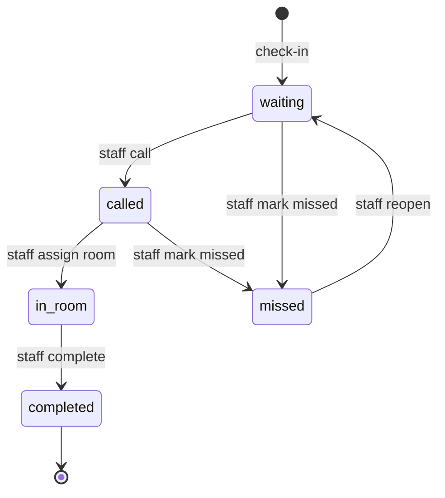

# Option A System Specification — Requirements

Date: 2026-10-10. Source: Claude Doc "Option A System Specification", tab Requirements, https://claude.ai/code/artifact/ed5a3cb3-2edb-4e6d-ac36-fc7021e61af0

This specification covers the frozen Option A prototype: fictional data only, staff always in control, no clinical data, not an MOH-approved or official system. Requirement IDs match the validation report and the MVP Scope doc.

## 1. Actors and permissions

| Actor | Can do | Cannot do |
| --- | --- | --- |
| Mother (patient) | Activate account, log in, check in, view own queue status and next appointment, read notifications | See other patients, change appointments, see staff notes |
| Nurse | Check in walk-ins, view queue, assign room or nurse, set status, flag urgent with reason, search patients (minimal profile), issue activation codes | Edit clinical data (none exists), change audit log, see other clinics |
| Clinic admin | Everything a nurse can, plus manage rooms and staff accounts, revoke devices, view audit log | Access other clinics |
| System | Issue rotating QR tokens, validate check-ins, record audit entries, send status notifications | Reorder queue or set urgency on its own |

## 2. Functional requirements

Priority is MoSCoW for this prototype. Acceptance criteria use Given / When / Then.

| ID | Requirement | Actor | Priority | Acceptance criteria |
| --- | --- | --- | --- | --- |
| FR-01 | Activate an account with a one-time code issued by staff | Mother, nurse | Must | Given a valid unused code, when the mother sets a password, then the account is active and the code is spent; an expired or reused code is refused |
| FR-02 | Confirm the patient is registered at this clinic before check-in | System | Must | Given a patient of another clinic, when she checks in, then the request is refused with a clear message and nothing is created |
| FR-03 | QR check-in with a rotating, short-lived token containing no personal data | Mother, system | Must | Given a valid token and a logged-in registered patient with an appointment today, when she scans, then she receives a queue number; an expired or unknown token is rejected |
| FR-04 | Assisted check-in by staff for walk-ins and mothers without a phone | Nurse | Must | Given a patient or a new walk-in name, when the nurse checks her in, then a queue entry exists with the same fields as a QR check-in |
| FR-05 | Queue board with live status: waiting, called, in room, completed, missed | Nurse, mother | Must | Given a status change, then the board and the mother's app show it within a few seconds; invalid transitions are refused |
| FR-06 | Assign room, nurse or service by staff action only | Nurse | Must | Given an entry, when staff assign a room, then it is saved and audit-logged; the system never changes order or assignment on its own |
| FR-07 | Urgent flag with a mandatory reason | Nurse | Should | Given a flag without a reason, then it is refused; with a reason, the entry is marked and the action logged |
| FR-08 | Patient search with a minimal profile | Nurse | Must | Given a name or phone fragment, then results show only display name, clinic and today's appointment |
| FR-09 | Next appointment shown read-only | Mother | Should | Given an appointment, then the mother sees date, time and type and cannot edit it |
| FR-10 | Simulated status notifications with status text only | System | Should | Given a status change, then a notification is created with no clinical wording |
| FR-11 | Append-only audit log | System, admin | Must | Given any of login, check-in, assignment, status change, urgent flag, search or activation, then an entry records who, what, when and from where; entries cannot be edited |
| FR-12 | Permanent safety notice after check-in | Mother | Must | Given any post-check-in screen, then the notice "tell staff immediately or go to a hospital if you are worried" is visible; wording to be approved by MOH before any real use |
| FR-13 | Duplicate check-in is idempotent | System | Must | Given a second check-in the same day or a retried request, then the existing queue entry is returned |
| FR-14 | Staff can mark an entry as missed or reopen it | Nurse | Should | Given a missed entry, then status and reason are logged; no automatic penalty or message to the mother beyond status |
| FR-15 | Staff reset a forgotten password after ID check | Nurse, admin | Should | Given a reset, then a one-time code is issued and the old sessions are revoked |
| FR-16 | Language switch between Bahasa Malaysia and English | All | Must | Given a language choice, then all screens and messages follow it |

**Won't build in the prototype:** estimated waiting time, clinical data, risk colour logic, fetal movement tools, booking or rescheduling, automatic routing, caregiver access.

## 3. Business rules

- One active queue entry per patient per clinic per day.
- Queue numbers are per clinic per day, prefixed A for scanned check-ins and W for walk-ins; numbers are never reused on the same day.
- QR token lifetime is short (proposed 60 seconds) and tied to one clinic; a token cannot be used for another clinic.
- Activation codes are single use and expire (proposed 7 days).
- Only staff set urgent flags, rooms and order changes; every such action requires a reason when it moves someone ahead.
- The mother's app shows queue number and status only, never other patients' data.
- Public display mode shows queue numbers only, never names.

## 4. Queue status model

All transitions are staff actions except the initial check-in; each writes an audit entry.

## 5. Non-functional requirements

| ID | Area | Requirement | How to verify |
| --- | --- | --- | --- |
| NFR-01 | Security | Role-based access; every query scoped to the user's clinic; patients see only their own rows | Automated tests for cross-clinic and cross-patient access |
| NFR-02 | Security | TLS in transit; hashed passwords; short-lived access tokens with refresh and revocation | Config review; token expiry test |
| NFR-03 | Privacy | Store only fictional minimal data; no IC number, address or clinical values | Schema review; seed data check |
| NFR-04 | Performance | Check-in confirmation and queue refresh feel instant on a slow mobile link; typical response under 2 s (proposed target) | Timed tests on throttled network |
| NFR-05 | Reliability | Idempotent check-in; retries safe; clear offline state in the app | Retry and offline tests |
| NFR-06 | Availability | Prototype is best effort; a paper fallback is documented | Fallback described in README |
| NFR-07 | Accessibility | Target WCAG 2.2 AA; large touch targets; screen-reader labels | Automated and manual checks |
| NFR-08 | Localisation | Bahasa Malaysia and English on every screen | Language review |
| NFR-09 | Low bandwidth | Small payloads; no large images; polling fallback if live connection fails | Network throttling test |
| NFR-10 | Auditability | Audit entries append-only and queryable by admin | Update and delete attempts fail |
| NFR-11 | Backup | Daily database backup and one tested restore | Restore drill |
| NFR-12 | Interoperability | Internal model can later map to HL7 FHIR resources; no integration in the prototype | Design note only |

## 6. Assumptions and open items

- The clinic registration rule (any nearby clinic or residential zone) is unconfirmed.
- Whether CCMS already handles antenatal check-in is unconfirmed; if it does, stop and reassess.
- Queue logic does not use risk colour until nurses confirm how it affects flow.
- FR-12 wording needs MOH approval before any real use.
