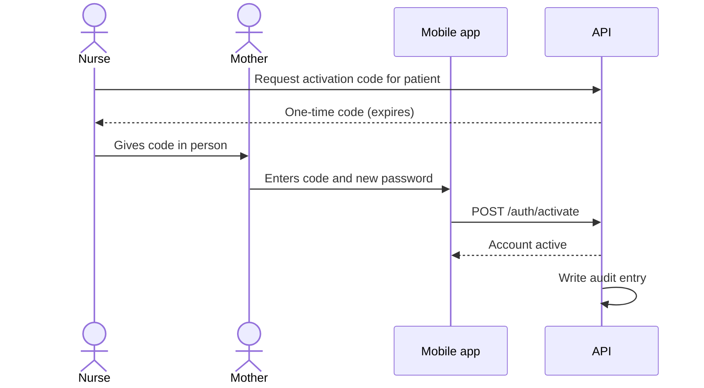
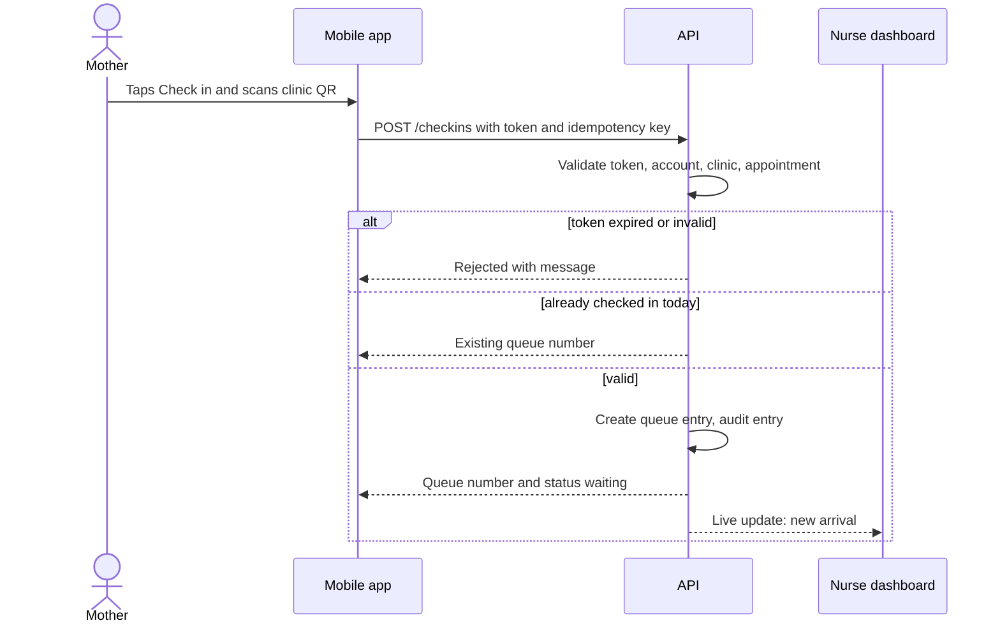
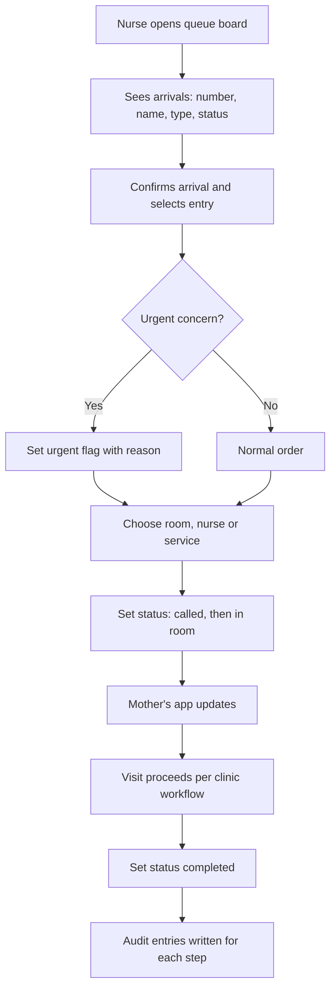
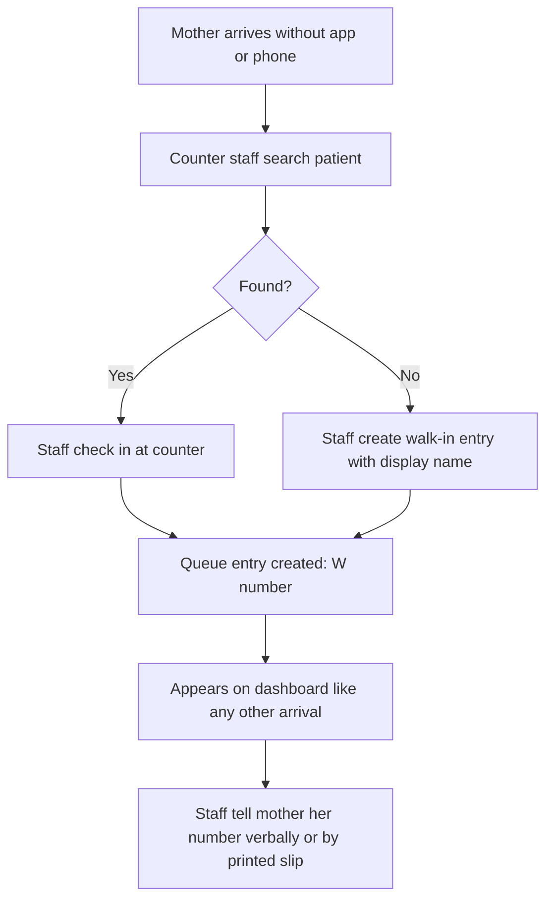

# Option A System Specification — User flows

Source: Claude Doc "Option A System Specification", tab User flows, https://claude.ai/code/artifact/ed5a3cb3-2edb-4e6d-ac36-fc7021e61af0

Flows are a proposed design for the fictional-data prototype, not an approved clinic workflow. Each flow cites the requirements it satisfies.

## UF-01 Account activation (FR-01, FR-15)

Alternative: wrong or expired code shows an error and asks her to see staff.

## UF-02 Mother checks in by QR (FR-02, FR-03, FR-13)

## UF-03 Nurse manages the queue (FR-05, FR-06, FR-07, FR-11)

## UF-04 Walk-in or no smartphone (FR-04)

## UF-05 Exceptions

| ID | Situation | Behaviour | Requirement |
| --- | --- | --- | --- |
| UF-05a | Invalid or expired QR | App shows a clear error and a prompt to ask staff; nothing is created | FR-03 |
| UF-05b | Duplicate check-in or retry | Existing queue number returned | FR-13 |
| UF-05c | Forgotten password | Staff issue a reset code after ID check; old sessions revoked | FR-15 |
| UF-05d | Wrong clinic | Refused; message says to see staff | FR-02 |
| UF-05e | No internet | App shows an offline banner and the last known status; mother goes to counter | NFR-05 |
| UF-05f | Urgent concern | App notice tells her to speak to staff or go to hospital; staff may flag urgent and move her ahead with a reason | FR-07, FR-12 |
| UF-05g | Nurse or room unavailable | Staff reassign; mother sees the new room | FR-06 |
| UF-05h | Mother misses her turn | Staff mark missed; may reopen; no penalty | FR-14 |
| UF-05i | System downtime | Clinic uses the paper queue; entries re-keyed afterwards if wanted | NFR-06 |
| UF-05j | Lost phone | Admin revokes the device; mother re-activates with a new code | FR-15 |

## UF-06 Screen navigation

Mobile: Activate or log in, then Home (next appointment, Check in button, safety notice), Scan QR, Confirmation, Live status, Notifications, Settings. Staff web: Log in, Queue board (default), Manual check-in, Patient search, Assignment dialog, Activation codes, Audit log (admin). Wireframes for each screen are in `docs/wireframes/`.
