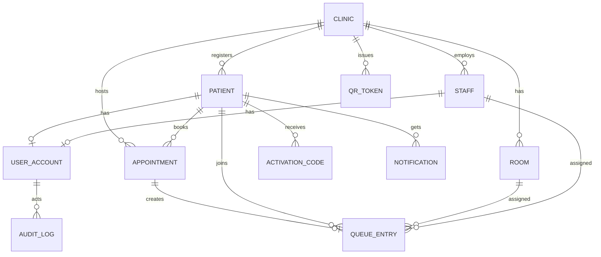

# Option A System Specification — Database design

Source: Claude Doc "Option A System Specification", tab Database design, https://claude.ai/code/artifact/ed5a3cb3-2edb-4e6d-ac36-fc7021e61af0

PostgreSQL schema for the prototype, managed with Entity Framework Core migrations. Only fictional minimal data is stored. Not stored: IC number, address, diagnoses, clinical values, risk colour.

## 1. Entity relationship diagram

## 2. Tables

Types are PostgreSQL. PK = primary key, FK = foreign key, UQ = unique. All tables have `created_at timestamptz` (default now).

**clinic**

| Column | Type | Notes |
| --- | --- | --- |
| id | uuid PK | |
| code | text UQ | Demo code, e.g. KK-DEMO-1 |
| name | text | Fictional clinic name |
| timezone | text | Default Asia/Kuala_Lumpur |

**staff**

| Column | Type | Notes |
| --- | --- | --- |
| id | uuid PK | |
| clinic_id | uuid FK clinic | |
| display_name | text | Fictional |
| role | text | nurse or clinic_admin |
| active | boolean | |

**patient**

| Column | Type | Notes |
| --- | --- | --- |
| id | uuid PK | |
| clinic_id | uuid FK clinic | Registered clinic |
| display_name | text | Fictional, e.g. Siti (demo) |
| phone | text | Fictional |
| language | text | ms or en |
| is_demo | boolean | Always true in the prototype; check constraint enforces it |

**user_account**

| Column | Type | Notes |
| --- | --- | --- |
| id | uuid PK | |
| patient_id | uuid FK patient, nullable | One of patient_id or staff_id |
| staff_id | uuid FK staff, nullable | Check: exactly one is set |
| username | text UQ | |
| password_hash | text | Identity hasher |
| status | text | pending, active, disabled |
| failed_logins | int | For lockout |
| locked_until | timestamptz | |

**refresh_token** (user_id FK, token_hash, device_name, expires_at, revoked_at) supports device revoke.

**activation_code**

| Column | Type | Notes |
| --- | --- | --- |
| id | uuid PK | |
| patient_id | uuid FK | |
| code_hash | text | Store a hash, show the code once |
| issued_by | uuid FK staff | |
| expires_at | timestamptz | |
| used_at | timestamptz | Null until used |

**appointment**

| Column | Type | Notes |
| --- | --- | --- |
| id | uuid PK | |
| patient_id | uuid FK | |
| clinic_id | uuid FK | |
| scheduled_at | timestamptz | |
| visit_type | text | booking, routine, virtual (label only) |
| status | text | scheduled, checked_in, cancelled |

**qr_token**

| Column | Type | Notes |
| --- | --- | --- |
| id | uuid PK | |
| clinic_id | uuid FK | |
| token_hash | text UQ | Opaque random value, no personal data |
| expires_at | timestamptz | About 60 seconds ahead |

**room** (id PK, clinic_id FK, name, active)

**queue_entry**

| Column | Type | Notes |
| --- | --- | --- |
| id | uuid PK | |
| clinic_id | uuid FK | |
| patient_id | uuid FK, nullable | Null for an unlinked walk-in |
| walk_in_name | text | Used when patient_id is null |
| appointment_id | uuid FK, nullable | |
| queue_date | date | For daily numbering |
| queue_no | text | A014 or W003 |
| source | text | qr or staff |
| status | text | waiting, called, in_room, completed, missed |
| urgent | boolean | Set by staff only |
| urgent_reason | text | Required when urgent |
| room_id | uuid FK, nullable | |
| staff_id | uuid FK, nullable | Assigned nurse |
| idempotency_key | text | Unique per patient and day |
| checked_in_at | timestamptz | |
| called_at, started_at, completed_at | timestamptz | Timing only |

**notification** (id, patient_id FK, kind, body_text, created_at, read_at); body_text holds status wording only.

**audit_log**

| Column | Type | Notes |
| --- | --- | --- |
| id | bigint identity PK | |
| at | timestamptz | |
| actor_user_id | uuid, nullable | Null for system |
| clinic_id | uuid | |
| action | text | login, activation, checkin, assign, status, urgent, search, reset |
| entity | text | Table name |
| entity_id | text | |
| detail | jsonb | Reason and old and new status; no personal data beyond ids |
| ip | inet | |

## 3. Keys, indexes and constraints

- Unique: (clinic_id, queue_date, queue_no); (patient_id, queue_date) where status is not completed or missed (one active entry per patient per day); (idempotency_key, patient_id, queue_date).
- Check: urgent = true requires urgent_reason; patient_id or walk_in_name must be set; user_account has exactly one of patient_id or staff_id; patient.is_demo = true.
- Indexes: queue_entry (clinic_id, queue_date, status); appointment (patient_id, scheduled_at); qr_token (expires_at); audit_log (clinic_id, at); patient (clinic_id, display_name).
- Foreign keys use restrict on delete; no hard deletes of audit rows.
- audit_log is append-only: the application database role has insert and select only; a trigger blocks update and delete.
- Clinic scoping: every staff query filters by clinic_id from the token; consider PostgreSQL row-level security as a second layer.

## 4. Seed data (all fictional)

| Table | Seed |
| --- | --- |
| clinic | KK Demo Satu |
| staff | Aini (demo, nurse), Faridah (demo, clinic admin) |
| room | Bilik 1, Bilik 2, Bilik 3 |
| patient | Siti (demo), Dewi (demo), Mei Ling (demo), Priya (demo), each with a phone like 01x-xxx 0001 |
| appointment | One appointment today per patient, visit type routine |

## 5. Data lifecycle and later changes

- Prototype data is disposable: a script resets the database to seed state.
- Before any real use, add retention and deletion rules, consent records, and encryption review; none of those apply to fictional data.
- Clinical tables (antenatal record, observation, fetal movement) are intentionally absent and need MOH approval before design.
